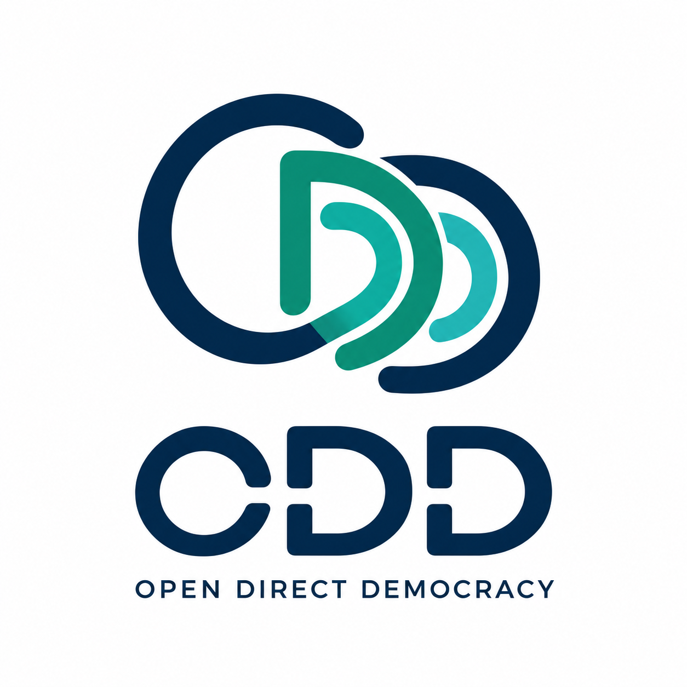

# Open Direct Democracy

>*Direct democracy (or pure democracy) is a form of democracy in which the electorate directly decides on policy initiatives, without elected representatives as proxies, as opposed to the representative democracy model which occurs in the majority of established democracies.*

<p align="center">
  <picture>
    
  </picture>
</p>


## What is it? That's odd!
**ODD stands for Open Direct Democracy. That's a bit odd, just as each of us is.**

*This is both an experiment and an attempt to determine whether a form of democratic collaboration, originating in the software sector, can transcend its limitations and shape the democratic life of communities—whether local, regional, or national.*

The goal of ODD is to provide a solution that acts as the core of a true and pure democracy:
- Promoting citizen membership & participation
- Direct drafting and voting on laws
- Preventing representatives and intermediaries that act as proxies
- Protecting against subversion, regression, deception, technological or social hacking, and direct attacks through rules and a defense mechanism
- Preventing any form of internal division or segregation in which a group or subgroup might seize power
- Granting higher privileges and permissions to citizens who have earned the system's trust
- Ensuring that every action within the system is transparent and visible to the majority of citizens
- Promoting freedom and the fulfillment of individuals and the people
- Designing ODD's own system collaboratively and democratically


**An odd number cannot be divided. The same should be true of a people. That's why it's quite ODD!**


## The Stack Overflow analogy

ODD can be thought of as a citizen democratic system, such as [Stack Overflow](https://stackoverflow.com) is for developers or any of its communities.  
A member earns reputation points whenever other members acknowledge their participation and the member interacts positively with the system.  
This principle could serve as the foundation for establishing a democratic system capable of governing a region or a country.

## Advantages of a direct democracy

- People are regaining their power
- The risk of power becoming concentrated in the hands of a few is prevented
- Citizens are key players in shaping their country's development and history
- There are no longer any kings, presidents, ministers, members of Congress, or people who dangerously concentrate a significant amount of power to the detriment of the people. Only citizens, only the people. The people are the state, the power, and the citizens all together.
- Its structure is more organic and can evolve organically. Dysfunctions are naturally eliminated through a constant and fluid democratic process.

## Fundamental architectural principle
### The ODD governance model
**There is no state, or any concentrated power, because the citizens are the state.**
```text

                  +------------------------------+
                  |           CITIZENS           |
          +------>|                              |
          |       |  Equal political rights      |
          |       |  and sovereignty             |
          |       +--------------+---------------+
          |                      |
          |                      v
          |       +------------------------------+
          |       |  DIRECT DEMOCRATIC PROCESS   |
          |       |                              |
          |       |  Proposals - Discussion      |
          |       |  Amendments - Voting         |
          |       +--------------+---------------+
          |                      |
          |                      v
          |       +------------------------------+
          |       |     PUBLIC ADMINISTRATION    |
          |       |                              |
          |       |  Execution - Services        |
          |       |  Implementation              |
          |       +--------------+---------------+
          |                     ^ |
          |                     | v
          |       +------------------------------+
          |       |       CITIZEN OVERSIGHT      |
          |       |                              |
          |       |  Auditing - Accountability   |
          |       |  Correction - Replacement    |
          |       +--------------+---------------+
          |                      |
          |                      |
          |                      |
          +<---------------------+
    The administration serves the citizens; it does not govern them.  
    The feedback loop represents the citizens' continuous ability to monitor, evaluate and correct the execution of their democratic decisions.  
```

# Constitution
A draft constitution is currently being developed and [is available here](./constitution/constitutional-framework.md).

# Contributing or collaborating to ODD
Contributions and collaboration are strongly encouraged! Since ODD is currently in its early stages, [let's first discuss together how to develop or modify it](https://github.com/jaenyf/odd/discussions)!

## Licence
[AGPL v3](./LICENCE)  
